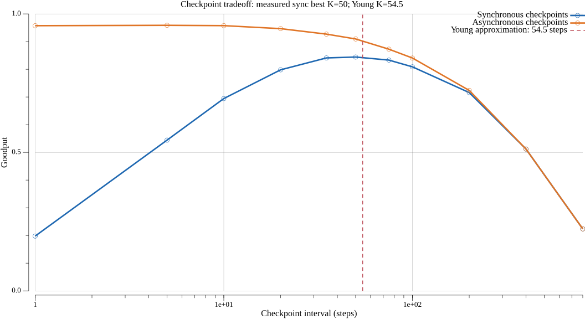

A small Go lab showing how large training jobs keep going when hardware fails constantly. Workers are simulated, there are no GPUs.

# training-goodput-lab

[The Llama 3 Herd of Models](https://arxiv.org/abs/2407.21783), section 3.3.4, reports 419 unexpected interruptions during a 54-day snapshot on 16,384 H100 GPUs. About 78% were attributed to confirmed or suspected hardware issues. Synchronous training means one failed GPU can stop the whole job; failures such as NVLink stalls can hang without returning an error.

The `llama3` preset calibrates the overall interruption rate to that snapshot: a whole-job MTBF of `54 × 24 / 419 ≈ 3.09 hours` at 16,384 workers, or a per-worker MTBF of approximately 50,677 hours. The preset treats all 419 interruptions as injected events. Its crash/hang/slow mix is an educational choice, not a measurement from the paper.

## Architecture

Two execution modes use the same coordinator engine for step counts, checkpoint policy, rollback, spare accounting, and straggler detection:

- `live` runs one TCP coordinator and real worker processes. A barrier waits for all active workers before advancing the global step. Spare processes register and wait for promotion.
- `sim` advances a seeded virtual clock and models worker timing and faults without launching thousands of processes or sleeping through simulated days.

```text
workers + spares ── TCP / virtual events ── coordinator
                                              │
                                      synchronous barrier
                                              │
                              checkpoint → detect → rollback
                                              │
                                    promote spare → resume
```

Workers hold a step counter, deterministic fake loss, and configurable byte blob. The simulator aggregates healthy workers into a synchronous cohort and tracks exceptional workers individually, keeping memory and scheduling practical at 16,384 workers.

Live checkpoint files contain the actual state, are published atomically, and include a SHA-256 checksum. Restore reads the durable checkpoint and replay produces the same state. The simulation models checkpoint timing and committed step boundaries rather than writing a file for each virtual GPU.

| Failure | What happens | Detection |
| --- | --- | --- |
| Crash | Process exits, TCP disconnects, or heartbeats stop | Connection closure or heartbeat timeout |
| Silent hang | Worker keeps sending heartbeats but stops completing steps | Per-step progress watchdog |
| Straggler | Worker completes steps persistently slower than peers | Sliding window of worker durations compared with the peer median |

Recovery cancels the current barrier, removes the bad worker, promotes a spare, rolls every active worker back to the latest completed checkpoint, and resumes at the next step. Completed steps after that checkpoint count as lost. Spare exhaustion stops progress instead of silently inventing replacements.

## Run live mode

Install the Go version specified by `go.mod`, then build the binaries so the PID you kill belongs to the worker itself:

```sh
go build -o bin/coordinator ./cmd/coordinator
go build -o bin/worker ./cmd/worker
./bin/coordinator --workers 8 --spares 2 --checkpoint-every 50
```

In another terminal, launch ten workers for eight active slots and two spares:

```sh
mkdir -p run
for i in $(seq 1 10); do
  ./bin/worker --coordinator localhost:9000 --id "worker-$i" > "run/worker-$i.log" 2>&1 &
  echo "$!" > "run/worker-$i.pid"
done
```

Wait until the coordinator reports steps and at least one checkpoint, then kill an active worker:

```sh
kill -9 "$(cat run/worker-1.pid)"
```

The coordinator logs detection, rollback, spare promotion, and resumed steps. Registration order determines which eight workers are initially active; choose a worker shown as active in the coordinator output. Stop the coordinator with Ctrl-C to write its run metrics. Clean up the remaining workers afterward:

```sh
for pidfile in run/*.pid; do kill "$(cat "$pidfile")" 2>/dev/null || true; done
```

The equivalent source commands are:

```sh
go run ./cmd/coordinator --workers 8 --spares 2 --checkpoint-every 50
go run ./cmd/worker --coordinator localhost:9000
```

For a shorter demonstration, use `--checkpoint-every 10`. Use `--steps 100` for a bounded run and `--async` for asynchronous checkpointing. The coordinator defaults to 100 ms steps, a 500 ms synchronous checkpoint cost, a 1 s heartbeat timeout, and a 2 s progress watchdog.

Inject a persistent fault by starting one worker with any of these flags while starting the other workers normally:

```sh
./bin/worker --id faulty --fault hang --fault-after 20
./bin/worker --id faulty --fault crash --fault-after 20
./bin/worker --id faulty --fault slow --fault-after 20 --slow-factor 5
```

Use one fault command per demonstration. The coordinator also supports a seeded injector, for example `--mtbf-per-gpu 30s --seed 42`, with `--crash-weight`, `--hang-weight`, and `--slow-weight`. `--blob-bytes` controls real state size. `--drift 0.03 --drift-day 1m` makes a small thermal-style timing cycle visible quickly. Workers on the same host use the shared `.training-goodput` directory by default; these local checkpoint paths assume a shared filesystem.

## Run the deterministic simulation

```sh
go run ./cmd/sim --gpus 16384 --days 54 --preset llama3 --checkpoint-every 200 --seed 42
```

Simulation output goes to `results/sim/run.csv` and `results/sim/timeline.png`; `--output` changes that directory. The same seed and flags produce identical simulated events and CSV output. Virtual time makes a many-day simulation practical without GPUs. Run `go run ./cmd/sim --help` for timing, fault mix, per-GPU MTBF, spare count, and detector options. `--watchdog=false` demonstrates why heartbeats cannot establish training progress: a silent hang can keep the entire barrier blocked.

## Checkpoint experiments

```sh
go run ./cmd/sweep --preset llama3
```

Outputs go to `results/` by default, with one CSV per run and an `experiments.csv` summary. The sweep compares checkpoint intervals, synchronous and asynchronous writes at the same interval, heartbeat-only versus progress-watchdog detection, and cluster sizes at a fixed per-worker failure rate. It writes CSV data and these PNG charts using `gonum/plot`:

| Chart | Purpose |
| --- | --- |
| `goodput_vs_checkpoint_interval.png` | Checkpoint interval sweep with predicted and measured optima |
| `goodput_vs_cluster_size.png` | Cluster size sweep at fixed per-GPU MTBF |
| `hang_detection_time.png` | Heartbeat-only and watchdog comparison |
| `timeline.png` | Steps over time, with faults, rollback and recovery events |



Frequent checkpoints consume time writing state. Infrequent checkpoints waste more completed work after each failure. The overhead curve is U-shaped; goodput, which measures useful work, has the corresponding peak. Random samples, detection delay, recovery cost, and asynchronous writes shift the measured best interval.

For synchronous writes, the leading Young/Daly approximation predicts the interval in useful training time:

```text
interval_seconds ≈ sqrt(2 × checkpoint_cost_seconds × whole_job_MTBF_seconds)
whole_job_MTBF = per_GPU_MTBF / active_GPU_count
K ≈ interval_seconds / base_step_seconds
```

With the default 54-day seed-42 experiment, the prediction is about 54.5 steps and the measured best synchronous interval is 50 steps. The chart marks that prediction next to the measured best. Asynchronous checkpoints briefly pause for a snapshot and then write in the background; only completed writes are durable, so a failure during a write rolls back to the previous completed checkpoint. At most one checkpoint is in flight; scheduled snapshots are skipped until its write completes.

## Metrics and validation

Every run writes a CSV and prints a summary table. Goodput is final useful step time divided by elapsed wall time, so replayed steps do not count twice. Reports include lost steps, detection and recovery durations by fault type, checkpoint overhead, and spares consumed. Undetected hangs are right-censored at the end of the run and excluded from mean detection times. Live externally killed processes have no exact fault-onset timestamp, so detection latency is estimated from their last heartbeat; injected faults report their onset. Times in CSV files use seconds; goodput is a fraction between zero and one.

```sh
go test ./...
go test -race ./...
```

Tests cover crash recovery with spare promotion, a hung worker that continues heartbeating, persistent stragglers, exact checkpoint restoration, deterministic simulation replay, and the goodput bound.

## Limitations

This is an educational lab, not a reproduction of Meta's infrastructure. There is no GPU computation or real all-reduce: a coordinator barrier stands in for synchronous distributed training. State and loss are synthetic. Checkpoint cost, network behavior, recovery, and thermal drift are simplified. The simulator uses a configured failure distribution rather than hardware telemetry and does not capture correlated rack failures, full storage contention, or real training quality. The Young/Daly interval is an approximation under model assumptions, not a deployment recommendation.

The code uses the Go standard library and `gonum/plot`. Packages separate coordinator policy, workers, faults, checkpoints, clocks, metrics, and charts; commands live under `cmd/coordinator`, `cmd/worker`, `cmd/sim`, and `cmd/sweep`.
